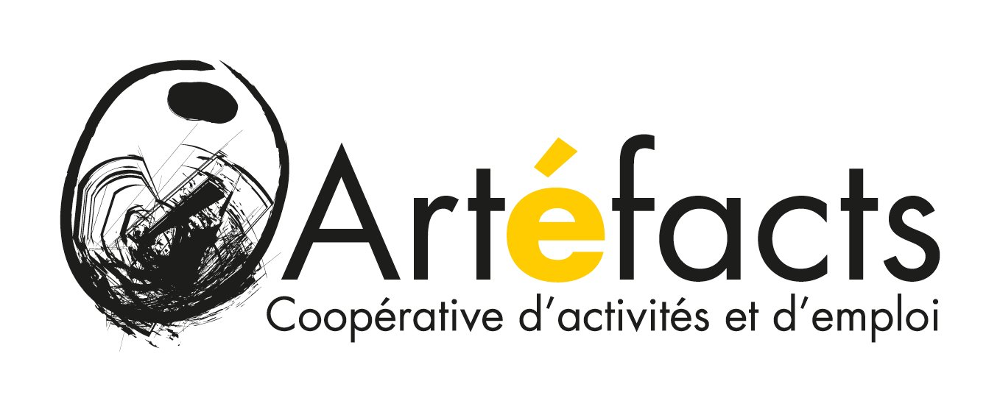

  <h1>Symposium Néguanthropique</h1>

  

---

#### Erwan BOZEC - Philippe Rivière - Luc Léger - Aline Perdereau, Néguentropie
Copyleft : sauf mention contraire, cette œuvre est libre, vous pouvez la copier, la diffuser et la modifier selon les termes de la [Licence Art Libre](https://artlibre.org).

**Sources et crédits de cette page**
- Consultation : [Polis](https://pol.is/) (The Computational Democracy Project, logiciel libre sous licence AGPL). Les contributions restent celles de leurs auteurs.

   
  <a href="https://artefacts.coop/">https://artefacts.coop</a>

