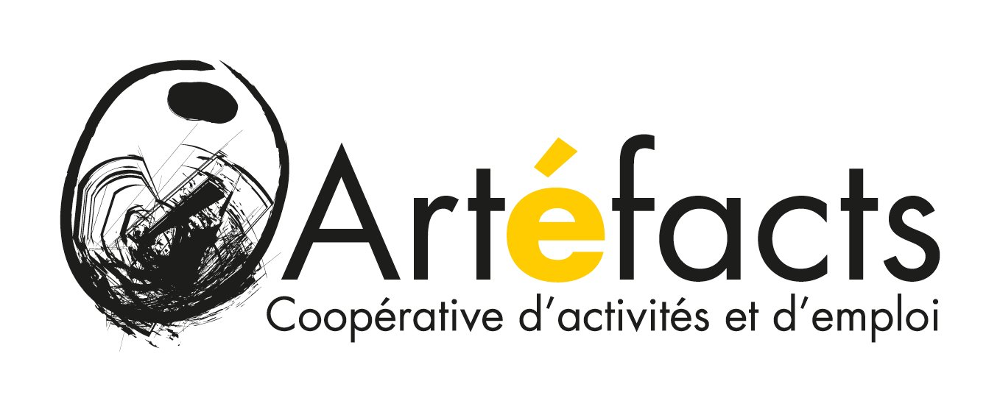

<div class="hero">
  <h1>Convertisseur Bibliographie CSL-JSON</h1>
  <h2>Importez vos bibliographies au format CSL-JSON et fusionnez-les avec le graphique Néguentropie</h2>
</div>

<div class="converter-container">

## 🔄 Fusion d'une bibliographie

Collez une bibliographie, en texte brut (un scan, un copier-coller) ou en CSL-JSON exporté depuis [AnyStyle.io](https://anystyle.io), et fusionnez-la avec le graphe existant.

```js
// Import existing graph data
const graphData = FileAttachment("./data/neguentropie_Graph.json").json();
```

<div class="input-section">

### 1. Sélectionner le livre source
Choisissez le nœud du graphe existant qui sera la source des nouvelles références.

```js
const existingNodes = graphData.nodes.map(n => n.id).sort();
const selectedSourceBook = view(Inputs.select(existingNodes, {
  label: "Livre Source",
  placeholder: "Sélectionnez un livre...",
  value: existingNodes.find(n => n === "Technè") // Default or empty
}));
```

### 2. Coller la bibliographie
Deux formats sont reconnus automatiquement :
- **texte brut**, une référence par ligne, par exemple le scan d'une bibliographie de livre : `A. Supiot, La Gouvernance par les nombres, Paris, Fayard, 2015.` Les erreurs de lecture courantes sont corrigées, et chaque correction est listée ;
- **CSL-JSON**, une liste qui commence par `[`, par exemple un export d'AnyStyle.

```js
const saisie = view(Inputs.textarea({
  placeholder: `A. Supiot, La Gouvernance par les nombres, Paris, Fayard, 2015.
A. Alombert, « Comment penser ChatGPT ? », Conseil national du numérique, avril 2023 : https://cnnumerique.fr/comment-penser-chatgpt

ou

[{"author": [{"family": "Stiegler", "given": "Bernard"}], "title": "La technique et le temps", …}]`,
  rows: 10,
  width: "100%",
  submit: false
}));
```

```js
import {texteVersCSL} from "./components/texte-brut.js";
```

```js
// Format : CSL-JSON si le texte commence par « [ », texte brut sinon.
const formatSaisie = !saisie?.trim() ? null : saisie.trim().startsWith("[") ? "csl" : "texte";
const analyseTexte = formatSaisie === "texte" ? texteVersCSL(saisie) : null;
// Ce que la suite de la page reçoit : toujours du CSL-JSON.
const cslInput = formatSaisie === "texte" ? JSON.stringify(analyseTexte.entrees, null, 2) : (saisie ?? "");
```

```js
if (analyseTexte) {
  const a = analyseTexte;
  const sansTitre = a.lignes.filter((l) => !l.entree.title);
  const TYPES = {book: "livre", chapter: "chapitre", "article-journal": "article", article: "article", webpage: "page web"};
  let numero = 0;
  const lignes = a.lignes.map((l) => ({
    ligne: l.n,
    entree: l.entree.title ? ++numero : "",
    auteurs: (l.entree.author ?? []).map((x) => x.literal ?? `${x.given} ${x.family}`).join(" ; "),
    titre: l.entree.title ?? "",
    annee: l.entree.issued ? String(l.entree.issued["date-parts"][0][0]) : "",
    type: TYPES[l.entree.type] ?? l.entree.type ?? "",
    source: l.entree["container-title"] ?? l.entree.publisher ?? "",
    doutes: l.doutes.join(" ; ")
  }));
  const LARGEURS = {n: 48, ligne: 48, entree: 40, auteurs: 160, titre: 320, annee: 52, type: 80, source: 170, doutes: 280, raison: 260, avant: 220, apres: 220, mot: 200};
  const tableau = (lignes, colonnes) => Inputs.table(lignes, {columns: Object.keys(colonnes), header: colonnes, width: LARGEURS, rows: 12, select: false});
  const colonnesRef = {ligne: "Ligne", entree: "N°", auteurs: "Auteurs", titre: "Titre", annee: "Année", type: "Type", source: "Revue ou éditeur", doutes: "À vérifier"};
  const aVerifier = lignes.filter((l) => l.doutes);
  display(html`<div>
    <p><strong>Texte brut :</strong> ${a.entrees.length} références lues
      (${a.entrees.filter((e) => e.issued).length} avec une année),
      ${a.corrections.length} corrections, ${a.lignes.filter((l) => l.doutes.length).length} références à vérifier.
      ${sansTitre.length ? html`<br>${sansTitre.length} ligne(s) sans titre, ignorée(s).` : ""}</p>
    ${a.corrections.length ? html`<details class="rapport"><summary>Corrections appliquées (${a.corrections.length})</summary>
      ${tableau(a.corrections, {n: "Ligne", raison: "Correction", avant: "Avant", apres: "Après"})}</details>` : ""}
    ${a.coupures.length ? html`<details class="rapport" open><summary>Mots peut-être coupés, à corriger dans le texte (${a.coupures.length})</summary>
      ${tableau(a.coupures, {n: "Ligne", mot: "Mot"})}</details>` : ""}
    ${aVerifier.length ? html`<details class="rapport" open><summary>Références à vérifier (${aVerifier.length})</summary>
      ${tableau(aVerifier, colonnesRef)}</details>` : ""}
    <details class="rapport"><summary>Toutes les références lues (${a.lignes.length})</summary>
      ${tableau(lignes, colonnesRef)}</details>
    <details class="rapport"><summary>CSL-JSON produit</summary>
      ${Inputs.textarea({value: cslInput, rows: 12, width: "100%", readonly: true})}</details>
  </div>`);
}
```

### 🔍 Vérification CSL (optionnel)

Vérifiez les références avant de les fusionner.

```js
import {verifyEntry} from "./components/bibliography-verifier.js";
import {mergeCSL, recupererTitre} from "./components/fusion-csl.js";
import {
  checkRetraction,
  detectHallucinationRisk,
  validateCSLFormat,
  detectDuplicates
} from "./components/bibcheck-enhanced.js";
```

```js
const verifyCSLButton = view(Inputs.button("🔍 Vérifier les références CSL", {
  value: null,
  reduce: () => "verify"
}));
```

```js
const cslVerificationTriggered = verifyCSLButton === "verify";

// Extract entries from CSL for verification
function extractCSLEntries(jsonText) {
  if (!jsonText || jsonText.trim() === "") return [];
  try {
    const data = JSON.parse(jsonText);
    return data.map(entry => {
      const {titre: title, auteurs: authorsList} = recupererTitre(entry);

      let author = "";
      if (authorsList.length > 0) {
        const a = authorsList[0];
        if (a.literal) author = a.literal;
        else if (a.family) author = a.given ? `${a.given} ${a.family}` : a.family;
      }
      
      let year = "";
      if (entry?.issued?.["date-parts"]?.[0]) {
        year = entry.issued["date-parts"][0][0];
      }

      return {
        title: title,
        author: author,
        year: year,
        originalUrl: entry?.URL
      };
    });
  } catch (e) {
    return [];
  }
}

const cslVerificationResults = cslVerificationTriggered && cslInput
  ? (async function*() {
      let cslData;
      try {
        cslData = JSON.parse(cslInput);
      } catch (e) {
        yield { loading: false, data: [], error: "JSON invalide", metadata: null };
        return;
      }
      
      const total = cslData.length;
      if (total === 0) {
        yield { loading: false, data: [], metadata: null };
        return;
      }

      // Initial loading state
      yield { loading: true, progress: { current: 0, total }, message: "Initialisation..." };
      
      // 1. Validation du format
      const formatValidation = validateCSLFormat(cslData);
      
      // 2. Détection de doublons
      const duplicates = detectDuplicates(cslData);
      
      // 3. Vérification dans les bases de données (CrossRef + BnF + HAL + OpenLibrary)
      const entries = extractCSLEntries(cslInput);
      const verificationResults = [];

      for (let i = 0; i < total; i++) {
        const entry = entries[i];
        
        // Yield progress update
        yield { 
          loading: true, 
          progress: { current: i + 1, total }, 
          message: `Vérification (${i + 1}/${total}): ${entry?.title?.substring(0, 40) || 'Entrée'}...` 
        };
        
        // Handle invalid entries
        if (!entry || !entry.title) {
            verificationResults.push({ original: entry || {}, verified: null, status: 'error', error: 'Titre manquant' });
            continue;
        }
        
        // Rate limiting: 300ms delay between requests
        if (i > 0) {
            await new Promise(r => setTimeout(r, 300));
        }
        
        // Vérification via BnF, HAL, CrossRef, OpenLibrary
        const result = await verifyEntry(entry);
        verificationResults.push(result);
      }
      
      // 4. Analyse de risque d'hallucination
      yield { loading: true, progress: { current: total, total }, message: "Analyse des hallucinations..." };
      const hallucinationAnalysis = cslData.map((entry, i) => 
        detectHallucinationRisk(entry || {}, verificationResults[i] || null)
      );
      
      // 5. Vérification des rétractations (CrossRef API + Retraction Watch)
      yield { loading: true, progress: { current: total, total }, message: "Vérification des rétractations..." };
      const retractionChecks = [];
      // Par DOI seulement : celui de la référence, ou celui d'une référence
      // vérifiée (jamais celui d'un résultat incertain, qui peut être un autre article).
      let appels = 0;
      for (let i = 0; i < cslData.length; i++) {
        const entry = cslData[i] || {};
        const v = verificationResults[i];
        const doi = entry.DOI || entry.doi || (v?.status === 'verified' ? v.verified?.doi : null);
        if (doi && appels++ > 0) await new Promise(r => setTimeout(r, 200));
        const result = await checkRetraction(doi);
        retractionChecks.push({ index: i, ...result });
      }
      
      // 6. Enrichir les résultats de vérification
      const enrichedResults = verificationResults.map((result, i) => {
        if (!result) return { status: 'error', original: cslData[i] }; // Safety fallback

        // Adjust hallucination risk based on verification status
        let hAnalysis = hallucinationAnalysis[i] || { level: 'unknown', riskScore: 0, reasons: [] };
        const verificationStatus = result.status;
        
        // Ensure reasons array exists
        if (!hAnalysis.reasons) hAnalysis.reasons = [];
        
        if (verificationStatus === 'not_found' || verificationStatus === 'uncertain') {
             // If not verified, increase risk
             if (hAnalysis.level === 'low') hAnalysis.level = 'medium';
             hAnalysis.riskScore = (hAnalysis.riskScore || 0) + 20;
             hAnalysis.reasons.push(`Non vérifié`);
        } else if (verificationStatus === 'verified') {
             // If verified, it's likely not a hallucination
             hAnalysis.level = 'low';
             hAnalysis.riskScore = 0;
             hAnalysis.reasons = [];
        }

        return {
            ...result,
            verification: {
              hallucinationRisk: hAnalysis.level,
              hallucinationScore: hAnalysis.riskScore,
              retracted: retractionChecks[i].retracted,
              formatIssues: formatValidation.issues.filter(issue => issue.index === i),
              isDuplicate: duplicates.some(d => d.indices.includes(i))
            }
        };
      });
      
      yield {
        loading: false,
        data: enrichedResults,
        metadata: {
          formatValidation,
          duplicates,
          hallucinationAnalysis,
          retractionChecks
        }
      };
    })()
  : { loading: false, data: [], metadata: null };
```

```js
// Display Progress Bar or Results
if (cslVerificationResults.loading) {
  const progress = cslVerificationResults.progress;
  const percentage = progress ? Math.round((progress.current / progress.total) * 100) : 0;
  
  display(html`<div class="loading-container">
    <div class="spinner"></div>
    <div style="flex: 1; margin-left: 1rem;">
      <p style="margin-bottom: 0.5rem;">${cslVerificationResults.message || 'Vérification en cours...'}</p>
      <div class="progress-bar-container">
        <div class="progress-bar-fill" style="width: ${percentage}%"></div>
      </div>
      <div style="font-size: 0.8rem; text-align: right; color: var(--theme-foreground-muted);">
        ${progress ? `${progress.current}/${progress.total} (${percentage}%)` : ''}
      </div>
    </div>
  </div>`);
} else if (cslVerificationResults.error) {
  display(html`<div class="error-box">❌ ${cslVerificationResults.error}</div>`);
} else if (cslVerificationResults.data && cslVerificationResults.data.length > 0) {
  const results = cslVerificationResults.data;
  const meta = cslVerificationResults.metadata;
  
  // --- Calcul des statistiques et du score ---
  const stats = {
    verified: results.filter(r => r.status === 'verified').length,
    uncertain: results.filter(r => r.status === 'uncertain').length,
    notFound: results.filter(r => r.status === 'not_found').length,
    duplicates: meta.duplicates.length,
    retracted: meta.retractionChecks.filter(r => r.retracted).length,
    hallucinations: meta.hallucinationAnalysis.filter(h => h.level === 'high').length,
    formatErrors: meta.formatValidation.issues.filter(i => i.severity === 'error').length
  };
  
  // Calcul du score (simplifié par rapport à bibcheck-enhanced.js mais cohérent)
  let score = 100;
  const total = results.length;
  
  // Pénalités
  score -= (stats.notFound / total) * 30; // Max 30 pts pour non trouvés
  score -= (stats.uncertain / total) * 10; // Max 10 pts pour incertains
  score -= stats.retracted * 20; // -20 par rétractation
  score -= stats.hallucinations * 15; // -15 par hallucination
  score -= stats.duplicates * 5; // -5 par doublon
  score -= stats.formatErrors * 2; // -2 par erreur de format
  
  score = Math.max(0, Math.round(score));
  const scoreEmoji = score >= 80 ? '✅' : score >= 60 ? '⚠️' : '❌';
  const scoreText = score >= 80 ? 'Excellente qualité' : score >= 60 ? 'Qualité acceptable' : 'Corrections nécessaires';

  // --- Affichage des Alertes ---
  const alerts = [];
  
  if (stats.retracted > 0) {
    const retractionDetails = meta.retractionChecks.filter(r => r.retracted).map(r => ({
      title: results[r.index]?.original?.title || 'Titre inconnu',
      warnings: [r.details, r.retractionDOI ? `Avis : https://doi.org/${r.retractionDOI}` : null].filter(Boolean)
    }));
    
    alerts.push({
      type: 'danger',
      icon: '🚨',
      title: 'Articles rétractés détectés',
      message: `${stats.retracted} article(s) rétracté(s) selon Crossref`,
      details: retractionDetails
    });
  }
  
  if (stats.hallucinations > 0) {
    alerts.push({
      type: 'warning',
      icon: '⚠️',
      title: 'Risque élevé de références hallucinées',
      message: `${stats.hallucinations} référence(s) à risque élevé`,
      details: meta.hallucinationAnalysis.filter(h => h.level === 'high').map((h, i) => ({
        title: results[i].original.title,
        warnings: h.reasons
      }))
    });
  }
  
  if (stats.duplicates > 0) {
    alerts.push({
      type: 'info',
      icon: '🔄',
      title: 'Doublons détectés',
      message: `${stats.duplicates} paire(s) de doublons potentiels`,
      details: meta.duplicates.map(d => ({
        title: `Doublon (indices ${d.indices.join(', ')})`,
        warnings: [`Type: ${d.type}`]
      }))
    });
  }
  
  if (stats.formatErrors > 0) {
    alerts.push({
      type: 'warning',
      icon: '❌',
      title: 'Erreurs de format CSL',
      message: `${stats.formatErrors} erreur(s) de format`,
      details: meta.formatValidation.issues.filter(i => i.severity === 'error').map(i => ({
        title: `Entrée ${i.index + 1}`,
        warnings: [i.message]
      }))
    });
  }

  if (alerts.length > 0) {
    display(html`<div class="alerts-container">
      ${alerts.map(alert => html`
        <div class="alert alert-${alert.type}">
          <div class="alert-header">
            <span class="alert-icon">${alert.icon}</span>
            <strong>${alert.title}</strong>
          </div>
          <p>${alert.message}</p>
          ${alert.details && alert.details.length > 0 ? html`
            <details>
              <summary>Voir les détails</summary>
              <ul>
                ${alert.details.map(d => html`<li>
                  <strong>${d.title}</strong>
                  ${d.warnings ? html`<ul>${d.warnings.map(w => html`<li>${w}</li>`)}</ul>` : ''}
                </li>`)}
              </ul>
            </details>
          ` : ''}
        </div>
      `)}
    </div>`);
  } else {
    display(html`<div class="alert alert-success">
      ✅ Aucune alerte critique détectée
    </div>`);
  }

  // --- Tableau de bord statistiques avec Score intégré ---
  display(html`<div class="stats-dashboard">
    <h3 style="display: flex; align-items: center; gap: 1rem;">
      📊 Statistiques de vérification
      <span style="margin-left: auto; font-size: 0.9rem; padding: 0.3rem 0.8rem; border-radius: 20px; background: ${score >= 80 ? 'rgba(75, 195, 182, 0.2)' : score >= 60 ? 'rgba(234, 179, 8, 0.2)' : 'rgba(239, 68, 68, 0.2)'}; color: ${score >= 80 ? '#4BC3B6' : score >= 60 ? '#eab308' : '#ef4444'};">
        ${scoreEmoji} Score: ${score}/100 — ${scoreText}
      </span>
    </h3>
    <div class="stats-grid">
      <div class="stat-card stat-verified">
        <div class="stat-number">${stats.verified}</div>
        <div class="stat-label">Vérifiées ✅</div>
      </div>
      <div class="stat-card stat-uncertain">
        <div class="stat-number">${stats.uncertain}</div>
        <div class="stat-label">Incertaines ⚠️</div>
      </div>
      <div class="stat-card stat-notfound">
        <div class="stat-number">${stats.notFound}</div>
        <div class="stat-label">Non trouvées ❌</div>
      </div>
      <div class="stat-card" style="border-color: #9333ea; background: rgba(147, 51, 234, 0.1);">
        <div class="stat-number">${stats.retracted}</div>
        <div class="stat-label">Rétractées 🚨</div>
      </div>
    </div>
  </div>`);

  // --- Tableau détaillé ---
  const tableData = results.map((r, i) => ({
      "Index": i + 1,
      "Statut": r.status === 'verified' ? '✅' : r.status === 'uncertain' ? '⚠️' : r.status === 'retracted' ? '🚨' : '❌',
      "Titre": r.original.title,
      "Auteur": r.original.author,
      "Source": r.verified?.source || "-",
      "Auteur trouvé": !r.verified ? "-" : `${r.verified.authorMatch === false ? "✗ " : r.verified.authorMatch ? "✓ " : ""}${r.verified.author || "?"}`,
      "Confiance": r.verified ? `${r.verified.confidence}%` : "-",
      "Risque IA": meta.hallucinationAnalysis[i]?.level === 'high' ? '🚨 Élevé' : 
                   meta.hallucinationAnalysis[i]?.level === 'medium' ? '⚠️ Moyen' : '✅ Faible',
      "Rétracté": meta.retractionChecks[i]?.retracted ? '🚨 Oui' : meta.retractionChecks[i]?.concern ? '⚠️ Avis de préoccupation' : meta.retractionChecks[i]?.checked ? 'Non' : '— (pas de DOI)'
  }));
  
  display(Inputs.table(tableData, {
    columns: ["Index", "Statut", "Titre", "Auteur", "Source", "Auteur trouvé", "Confiance", "Risque IA", "Rétracté"],
    width: "100%",
    rows: 15
  }));
}
```

</div>

<div class="output-section">

```js
const useVerifiedData = view(Inputs.toggle({label: "Compléter avec les références vérifiées (adresse, année, auteurs manquants)", value: true}));
```

### 3. Fusionner
La fusion garde vos titres et vos auteurs. Une référence vérifiée (titre et auteur retrouvés dans un catalogue) ne fait que compléter ce qui manque. Relisez le rapport ci-dessous avant de télécharger le fichier.

```js
const mergedGraph = (cslInput) 
  ? mergeCSL(cslInput, graphData, selectedSourceBook, cslVerificationResults.data, useVerifiedData)
  : graphData;
```


### 📊 Résultat de la fusion

```js
const rapport = mergedGraph.rapport;
display(mergedGraph.error ? html`<div class="error-box">❌ ${mergedGraph.error}</div>` : html`
<div class="stats-grid">
  <div class="stat-card">
    <div class="stat-number">${mergedGraph.stats ? mergedGraph.stats.newNodes : 0}</div>
    <div class="stat-label">Nouveaux Nœuds</div>
  </div>
  <div class="stat-card">
    <div class="stat-number">${mergedGraph.stats ? mergedGraph.stats.newEdges : 0}</div>
    <div class="stat-label">Nouvelles Relations</div>
  </div>
  <div class="stat-card">
    <div class="stat-number">${rapport ? rapport.ecartees.length : 0}</div>
    <div class="stat-label">Entrées écartées</div>
  </div>
  <div class="stat-card">
    <div class="stat-number">${mergedGraph.nodes.length}</div>
    <div class="stat-label">Total Nœuds</div>
  </div>
</div>
`);
```

```js
// Rapport : tout ce que la fusion a écarté, rapproché ou complété.
function partie(titre, lignes, colonnes, ouvert = false) {
  if (!lignes?.length) return "";
  return html`<details class="rapport" open=${ouvert}>
    <summary>${titre} (${lignes.length})</summary>
    ${Inputs.table(lignes, {columns: Object.keys(colonnes), header: colonnes, width: {n: 48}, rows: 12, select: false})}
  </details>`;
}
if (rapport) display(html`<div>
  <h3>Rapport de fusion</h3>
  ${partie("Entrées écartées", rapport.ecartees, {n: "N°", titre: "Titre", raison: "Raison"}, true)}
  ${partie("À vérifier", rapport.avertissements, {n: "N°", titre: "Titre", message: "Remarque"}, true)}
  ${partie("Rapprochées d'un nœud existant", rapport.rapprochements, {n: "N°", genre: "Nature", saisi: "Dans le CSL", noeud: "Nœud du graphe"}, true)}
  ${partie("Complétées depuis un catalogue", rapport.completees, {n: "N°", titre: "Titre", champs: "Champs ajoutés", source: "Source"})}
  ${partie("Nouvelles œuvres", rapport.oeuvres, {n: "N°", titre: "Titre", annee: "Année", url: "Adresse"})}
  ${partie("Nouveaux auteurs", rapport.auteurs, {n: "N°", nom: "Nom"})}
</div>`);
```

</div>

<div class="json-section">

## 💾 JSON Fusionné

```js
const mergedJsonOutput = JSON.stringify({nodes: mergedGraph.nodes, edges: mergedGraph.edges}, null, 2);
```

```js
view(Inputs.textarea({
  value: mergedJsonOutput,
  rows: 15,
  width: "100%",
  readonly: true
}));
```

<div class="download-section">

```js
function downloadMergedJSON() {
  const blob = new Blob([mergedJsonOutput], { type: 'application/json' });
  const url = URL.createObjectURL(blob);
  const a = document.createElement('a');
  a.href = url;
  a.download = 'neguentropie_Graph_merged.json';
  document.body.appendChild(a);
  a.click();
  document.body.removeChild(a);
  URL.revokeObjectURL(url);
}
```

```js
view(Inputs.button("📥 Télécharger le JSON Fusionné", {
  value: null,
  reduce: () => downloadMergedJSON()
}));
```

</div>

</div>

</div>

---

#### Erwan BOZEC - Philippe Rivière - Luc Léger - Aline Perdereau, Néguentropie
Copyleft : sauf mention contraire, cette œuvre est libre, vous pouvez la copier, la diffuser et la modifier selon les termes de la [Licence Art Libre](https://artlibre.org).

**Sources et crédits de cette page**
- Analyse des références : [AnyStyle](https://anystyle.io/) (export CSL-JSON).
- Vérification : catalogues et API de la [BnF](https://catalogue.bnf.fr/), [HAL](https://hal.science/), [Crossref](https://www.crossref.org/), [Open Library](https://openlibrary.org/) et [Retraction Watch](https://retractionwatch.com/).

<div style="text-align: center;">
  <br>
  <a href="https://artefacts.coop/">https://artefacts.coop</a>
</div>

<style>


.converter-container {
  max-width: 1200px;
  margin: 0 auto;
  padding: 0 1rem;
}

.input-section,
.output-section,
.json-section {
  background: rgba(255, 255, 255, 0.05);
  backdrop-filter: blur(10px);
  border-radius: 16px;
  padding: 2rem;
  margin: 2rem 0;
  border: 1px solid rgba(255, 255, 255, 0.1);
  box-shadow: 0 8px 32px rgba(0, 0, 0, 0.1);
}

.stats-grid {
  display: grid;
  grid-template-columns: repeat(auto-fit, minmax(200px, 1fr));
  gap: 1.5rem;
  margin: 2rem 0;
}

.stat-card {
  background: linear-gradient(135deg, rgba(147, 51, 234, 0.1), rgba(220, 38, 38, 0.1));
  border-radius: 12px;
  padding: 2rem;
  text-align: center;
  border: 1px solid rgba(147, 51, 234, 0.2);
  transition: transform 0.3s ease, box-shadow 0.3s ease;
}

.stat-card:hover {
  transform: translateY(-4px);
  box-shadow: 0 12px 24px rgba(147, 51, 234, 0.2);
}

.stat-number {
  font-size: 3rem;
  font-weight: 900;
  background: linear-gradient(135deg, #9333ea, #dc2626);
  -webkit-background-clip: text;
  -webkit-text-fill-color: transparent;
  background-clip: text;
  line-height: 1;
  margin-bottom: 0.5rem;
}

.stat-label {
  font-size: 1rem;
  color: var(--theme-foreground-muted);
  text-transform: uppercase;
  letter-spacing: 0.05em;
  font-weight: 600;
}

.download-section {
  margin-top: 1.5rem;
  display: flex;
  justify-content: center;
}

.download-section button {
  background: linear-gradient(135deg, #9333ea, #dc2626);
  color: white;
  border: none;
  padding: 1rem 2rem;
  font-size: 1.1rem;
  font-weight: 600;
  border-radius: 12px;
  cursor: pointer;
  transition: all 0.3s ease;
  box-shadow: 0 4px 12px rgba(147, 51, 234, 0.3);
}

.download-section button:hover {
  transform: translateY(-2px);
  box-shadow: 0 8px 24px rgba(147, 51, 234, 0.4);
}

.download-section button:active {
  transform: translateY(0);
}

.empty-state {
  text-align: center;
  padding: 3rem;
  color: var(--theme-foreground-muted);
  font-style: italic;
}

code {
  background: rgba(147, 51, 234, 0.1);
  padding: 0.2em 0.4em;
  border-radius: 4px;
  font-size: 0.9em;
}

pre {
  background: rgba(0, 0, 0, 0.3);
  border-radius: 8px;
  padding: 1rem;
  overflow-x: auto;
  border-left: 4px solid #9333ea;
}

h2 {
  color: var(--theme-foreground);
  margin-top: 2rem;
  margin-bottom: 1rem;
  font-weight: 700;
}

h3 {
  color: var(--theme-foreground-focus);
  margin-top: 1.5rem;
  margin-bottom: 0.75rem;
  font-weight: 600;
}

.url-section {
  margin-top: 1.5rem;
  padding: 1rem;
  background: rgba(147, 51, 234, 0.05);
  border-radius: 8px;
  border: 1px solid rgba(147, 51, 234, 0.15);
}

.url-header {
  display: flex;
  justify-content: space-between;
  align-items: center;
  margin-bottom: 1rem;
  flex-wrap: wrap;
  gap: 1rem;
}

.url-header p {
  margin: 0;
  color: var(--theme-foreground);
}

.url-header button {
  background: linear-gradient(135deg, #9333ea, #dc2626);
  color: white;
  border: none;
  padding: 0.5rem 1rem;
  font-size: 0.9rem;
  font-weight: 600;
  border-radius: 8px;
  cursor: pointer;
  transition: all 0.3s ease;
  box-shadow: 0 2px 8px rgba(147, 51, 234, 0.3);
}

.url-header button:hover {
  transform: translateY(-1px);
  box-shadow: 0 4px 12px rgba(147, 51, 234, 0.4);
}

.url-list {
  max-height: 300px;
  overflow-y: auto;
}

.url-list ul {
  list-style: none;
  padding: 0;
  margin: 0;
}

.url-list li {
  padding: 0.5rem;
  margin: 0.25rem 0;
  background: rgba(255, 255, 255, 0.03);
  border-radius: 4px;
  transition: background 0.2s ease;
}

.url-list li:hover {
  background: rgba(147, 51, 234, 0.1);
}

.url-list a {
  color: #9333ea;
  text-decoration: none;
  word-break: break-all;
  font-size: 0.9rem;
}

.url-list a:hover {
  text-decoration: underline;
}

.empty-state-small {
  text-align: center;
  padding: 1rem;
  color: var(--theme-foreground-muted);
  font-style: italic;
  font-size: 0.9rem;
}

details.rapport {
  margin: 0.75rem 0;
  padding: 0.5rem 1rem;
  border: 1px solid var(--theme-foreground-faintest);
  border-radius: 8px;
  background: var(--theme-background-b);
}

details.rapport summary {
  cursor: pointer;
  font-weight: 600;
  color: var(--theme-foreground-focus);
}

/* Bibcheck Styles */
.quality-score-container {
  display: flex;
  flex-direction: column;
  align-items: center;
  justify-content: center;
  margin: 2rem auto;
  gap: 1rem;
  width: 100%;
  padding: 3rem;
  background: rgba(255, 255, 255, 0.05);
  border-radius: 12px;
}

.loading-container {
  display: flex;
  flex-direction: column;
  align-items: center;
  justify-content: center;
  padding: 3rem;
  background: rgba(255, 255, 255, 0.05);
  border-radius: 12px;
  margin: 2rem 0;
}

.spinner {
  width: 50px;
  height: 50px;
  border: 4px solid rgba(255, 255, 255, 0.1);
  border-left-color: #9333ea;
  border-radius: 50%;
  animation: spin 1s linear infinite;
  margin-bottom: 1rem;
}

@keyframes spin {
  0% { transform: rotate(0deg); }
  100% { transform: rotate(360deg); }
}

.progress-bar-container {
  width: 100%;
  background-color: rgba(255, 255, 255, 0.1);
  border-radius: 4px;
  margin: 10px 0;
  overflow: hidden;
  height: 8px;
}

.progress-bar-fill {
  height: 100%;
  background-color: #9333ea;
  transition: width 0.3s ease;
  border-radius: 4px;
}

</style>
