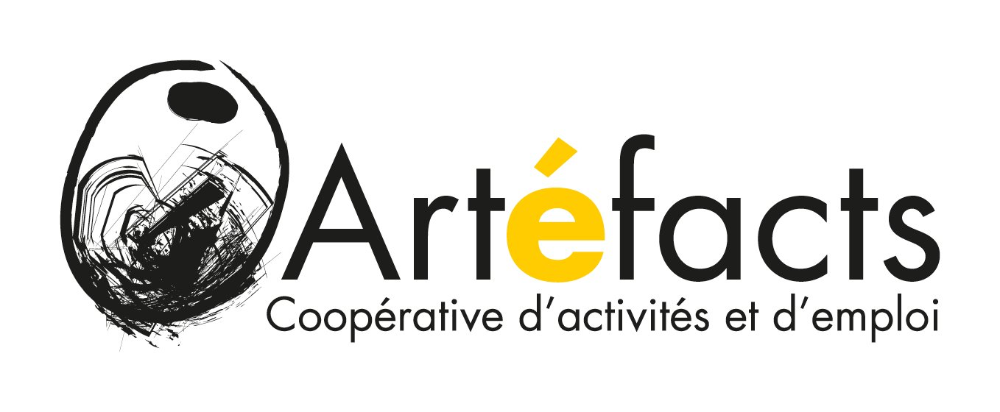

# Enveloppe icosaédrique 3 750 m³

```js
const viewerUrl = await FileAttachment("enveloppe-3d-viewer.html").url();

display(html`
<div style="display: flex; justify-content: space-between; align-items: center; margin-bottom: 1rem; flex-wrap: wrap; gap: 0.5rem;">
  <span style="color: var(--theme-foreground-muted); font-size: 0.95rem;">
    Visualisation 3D interactive (Three.js) &middot; Arête 12 m, hauteur &approx; 21 m, 3 passagers + 1 pilote
  </span>
  <a href="${viewerUrl}" target="_blank" rel="noopener noreferrer" style="display: inline-flex; align-items: center; gap: 6px; padding: 6px 12px; background: var(--theme-foreground-focus, #3b82f6); color: white; border-radius: 6px; text-decoration: none; font-size: 0.85rem; font-weight: 500;">
    <span>Ouvrir en plein écran</span>
    <svg width="14" height="14" viewBox="0 0 24 24" fill="none" stroke="currentColor" stroke-width="2" stroke-linecap="round" stroke-linejoin="round"><path d="M18 13v6a2 2 0 0 1-2 2H5a2 2 0 0 1-2-2V8a2 2 0 0 1 2-2h6"></path><polyline points="15 3 21 3 21 9"></polyline><line x1="10" y1="14" x2="21" y2="3"></line></svg>
  </a>
</div>

<div class="card" style="padding: 0; overflow: hidden; border-radius: 8px; box-shadow: 0 4px 12px rgba(0,0,0,0.08); border: 1px solid var(--theme-foreground-faintest);">
  <iframe
    src="${viewerUrl}"
    width="100%"
    height="780"
    style="border: none; display: block; width: 100%; height: 75vh; min-height: 600px;"
    title="Enveloppe icosaédrique 3D">
  </iframe>
</div>
`);
```

---

## 🎈 Points de décollage potentiels de montgolfière - Ballons du Léman

Carte des sites prestigieux dans un rayon de **60 km autour de Cossonay-Ville (Suisse)**.

*Critères : Intérêt touristique prestigieux pour la clientèle | Surface >= 1 hectare*

```js
import {Plot} from "https://cdn.jsdelivr.net/npm/@observablehq/plot@0.6.19/+esm";
import * as d3 from "https://cdn.jsdelivr.net/npm/d3@7.9.2/+esm";
import {feature} from "https://cdn.jsdelivr.net/npm/topojson-client@3.1.0/+esm";

// Coordonnées de Cossonay-Ville (centre)
const cossonay = {lon: 6.6500, lat: 46.6167, name: "Cossonay-Ville", type: "Centre"};

// Points de décollage potentiels (intérêt touristique + prestigieux + >= 1 hectare)
const landingPoints = [
  {lon: 6.6323, lat: 46.5197, name: "Lausanne - Ouchy", type: "Lac + Ville", area: 5, prestige: 5, tourism: "Lac Léman, vue Alpes"},
  {lon: 6.9275, lat: 46.4116, name: "Château de Chillon", type: "Patrimoine UNESCO", area: 3, prestige: 5, tourism: "Château médiéval"},
  {lon: 6.8358, lat: 46.4750, name: "Vevey - Riviera", type: "Lac + Culture", area: 8, prestige: 5, tourism: "Chaplin's World, Nestlé"},
  {lon: 6.9153, lat: 46.4806, name: "Montreux - Château", type: "Lac + Montagne", area: 10, prestige: 5, tourism: "Jazz Festival, vue Lavaux"},
  {lon: 6.4950, lat: 46.5100, name: "Morges - Domaine", type: "Vignoble", area: 12, prestige: 4, tourism: "Vignobles Lavaux UNESCO"},
  {lon: 6.6398, lat: 46.7781, name: "Yverdon-les-Bains", type: "Thermal + Nature", area: 15, prestige: 4, tourism: "Thermes, parc naturel"},
  {lon: 6.2333, lat: 46.3833, name: "Nyon - Domaine de Divonne", type: "Lac + Golf", area: 20, prestige: 4, tourism: "Golf, lac, vue Jura"},
  {lon: 6.1432, lat: 46.2044, name: "Genève - Aéroport", type: "International", area: 50, prestige: 5, tourism: "Ville internationale, Jet d'Eau"},
  {lon: 6.5800, lat: 46.6500, name: "Penthalaz - Domaine", type: "Campagne", area: 25, prestige: 3, tourism: "Vues panoramiques, calme"},
  {lon: 6.7000, lat: 46.5500, name: "Ecublens - Parc", type: "Innovation", area: 8, prestige: 4, tourism: "EPFL, lac proche"}
];

// Charger la carte de la Suisse
const world = await d3.json("https://cdn.jsdelivr.net/npm/world-atlas@2/countries-110m.json");
const switzerland = feature(world, world.objects.countries).features.find(d => d.id === 210 || d.properties.name === "Switzerland");

// Calculer la distance en km (formule de Haversine)
function haversineDistance(coord1, coord2) {
  const R = 6371; // Rayon de la Terre en km
  const dLat = (coord2.lat - coord1.lat) * Math.PI / 180;
  const dLon = (coord2.lon - coord1.lon) * Math.PI / 180;
  const a = Math.sin(dLat/2) * Math.sin(dLat/2) +
            Math.cos(coord1.lat * Math.PI / 180) * Math.cos(coord2.lat * Math.PI / 180) *
            Math.sin(dLon/2) * Math.sin(dLon/2);
  const c = 2 * Math.atan2(Math.sqrt(a), Math.sqrt(1-a));
  return R * c;
}

// Filtrer les points dans le rayon de 60 km
const radiusKm = 60;
const validPoints = landingPoints.filter(p => haversineDistance(cossonay, p) <= radiusKm);

// Créer le cercle de 60 km
const circlePoints = [];
for (let angle = 0; angle < 360; angle += 5) {
  const rad = angle * Math.PI / 180;
  const R = 6371;
  const d = radiusKm / R;
  const lat2 = Math.asin(Math.sin(cossonay.lat * Math.PI / 180) * Math.cos(d) +
                          Math.cos(cossonay.lat * Math.PI / 180) * Math.sin(d) * Math.cos(rad)) * 180 / Math.PI;
  const lon2 = cossonay.lon + (Math.atan2(Math.sin(rad) * Math.sin(d) * Math.cos(cossonay.lat * Math.PI / 180),
                                         Math.cos(d) - Math.sin(cossonay.lat * Math.PI / 180) * Math.sin(lat2 * Math.PI / 180))) * 180 / Math.PI;
  circlePoints.push({lon: lon2, lat: lat2});
}

// Échelle de couleurs par type
const colorScale = d3.scaleOrdinal()
  .domain(["Centre", "Lac + Ville", "Patrimoine UNESCO", "Lac + Culture", "Lac + Montagne", "Vignoble", "Thermal + Nature", "Lac + Golf", "International", "Campagne", "Innovation"])
  .range(["#ff0000", "#1f77b4", "#ff7f0e", "#2ca02c", "#d62728", "#9467bd", "#8c564b", "#e377c2", "#7f7f7f", "#bcbd22", "#17becf"]);

// Échelle de taille par superficie
const sizeScale = d3.scaleSqrt()
  .domain([1, 50])
  .range([8, 20]);

// Afficher la carte
const plot = Plot.plot({
  projection: {
    type: "mercator",
    domain: [[6.0, 7.0], [46.1, 46.9]]
  },
  marks: [
    // Fond de carte (Suisse)
    Plot.geo(switzerland, {fill: "#f0f0f0", stroke: "#999"}),
    
    // Cercle de 60 km
    Plot.line(circlePoints, {x: "lon", y: "lat", stroke: "#ff0000", strokeWidth: 2, strokeDasharray: "5,5"}),
    
    // Point central (Cossonay)
    Plot.dot([cossonay], {x: "lon", y: "lat", fill: "#ff0000", r: 12, tip: true}),
    Plot.text([cossonay], {x: "lon", y: "lat", text: d => d.name, dy: -15, fill: "#ff0000", fontWeight: "bold"}),
    
    // Points de décollage valides
    Plot.dot(validPoints, {
      x: "lon", 
      y: "lat", 
      fill: d => colorScale(d.type),
      r: d => sizeScale(d.area),
      tip: true
    }),
    
    // Étiquettes
    Plot.text(validPoints, {
      x: "lon", 
      y: "lat", 
      text: d => d.name,
      dy: -12,
      fill: "#333",
      fontSize: 10
    })
  ],
  height: 600,
  width: 900,
  style: {
    background: "#fff",
    fontSize: "12px"
  },
  title: `Points de décollage de montgolfière - Rayon ${radiusKm} km autour de Cossonay-Ville`,
  subtitle: "Critères: Intérêt touristique prestigieux | >= 1 hectare | Clientèle Ballons du Léman"
});

// Tableau des points valides
const tableData = validPoints.map(p => ({
  Site: p.name,
  Type: p.type,
  "Superficie (ha)": p.area,
  "Prestige": "★".repeat(p.prestige),
  "Intérêt touristique": p.tourism,
  "Distance (km)": haversineDistance(cossonay, p).toFixed(1)
})).sort((a, b) => parseFloat(a["Distance (km)"]) - parseFloat(b["Distance (km)"]));

display(html`<div style="margin-top: 20px; overflow-x: auto;">
  <h3 style="margin-bottom: 10px;">📋 Liste des sites valides (${validPoints.length} points)</h3>
  <table style="border-collapse: collapse; width: 100%; font-size: 14px;">
    <thead>
      <tr style="background: #f5f5f5;">
        <th style="padding: 8px; border: 1px solid #ddd; text-align: left;">Site</th>
        <th style="padding: 8px; border: 1px solid #ddd; text-align: left;">Type</th>
        <th style="padding: 8px; border: 1px solid #ddd; text-align: left;">Superficie</th>
        <th style="padding: 8px; border: 1px solid #ddd; text-align: left;">Prestige</th>
        <th style="padding: 8px; border: 1px solid #ddd; text-align: left;">Distance</th>
        <th style="padding: 8px; border: 1px solid #ddd; text-align: left;">Intérêt touristique</th>
      </tr>
    </thead>
    <tbody>
      ${tableData.map(row => `
        <tr>
          <td style="padding: 8px; border: 1px solid #ddd;"><strong>${row.Site}</strong></td>
          <td style="padding: 8px; border: 1px solid #ddd;">${row.Type}</td>
          <td style="padding: 8px; border: 1px solid #ddd;">${row["Superficie (ha)"]} ha</td>
          <td style="padding: 8px; border: 1px solid #ddd;">${row.Prestige}</td>
          <td style="padding: 8px; border: 1px solid #ddd;">${row["Distance (km)"]} km</td>
          <td style="padding: 8px; border: 1px solid #ddd;">${row["Intérêt touristique"]}</td>
        </tr>
      `).join('')}
    </tbody>
  </table>
  <p style="margin-top: 10px; color: #666; font-size: 12px;">
    ✈️ <strong>Note:</strong> Les points marqués sur la carte respectent les critères : 
    <em>intérêt touristique prestigieux pour la clientèle des Ballons du Léman</em> et 
    <em>surface minimale de 1 hectare</em>.
    <strong>À valider avec les propriétaires et autorités locales.</strong>
  </p>
</div>`);

display(plot);
```

---

#### Erwan BOZEC - Philippe Riviere - Luc Léger - Aline Perdereau, Néguentropie
Copyleft: cette œuvre est libre, vous pouvez la copier, la diffuser et la modifier selon les termes de la [Licence Art Libre](http://www.artlibre.org)



[https://artefacts.coop](https://artefacts.coop/)
