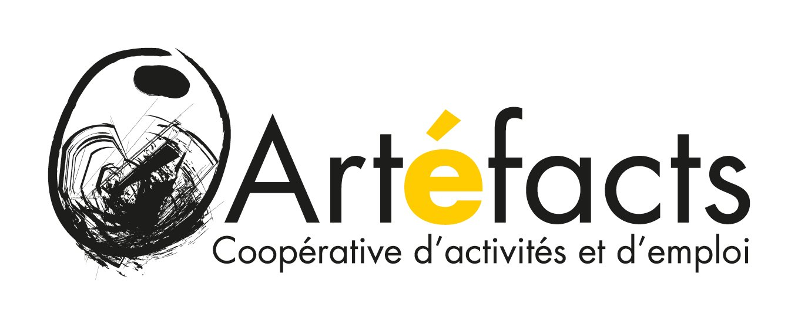

# Enveloppe icosaédrique 3 750 m³

<div class="grid grid-cols-2" style="gap: 2rem; margin-bottom: 1.5rem;">
<div>

### La carte Airocean sur l’enveloppe

L’enveloppe porte la carte Airocean, publiée par Buckminster Fuller en 1954 sous le nom « Airocean World Map » après une première version en 1943. Fuller projette la Terre sur un icosaèdre de vingt triangles, puis le déplie à plat. Il oriente l’icosaèdre de façon très précise pour qu’aucun continent ne soit coupé : les terres y forment une seule île dans un seul océan, sans haut ni bas. Sa transformation des triangles, formalisée par Robert W. Gray et implémentée par Philippe Rivière, rend la projection presque équivalente : les surfaces sont quasiment conservées.

Notre enveloppe est elle-même un icosaèdre, donc la carte y retrouve sa forme d’origine : chaque triangle correspond à une face. Dans la vue 3D, les trois orientations proposées placent le scoop et les ventaux sur les faces les moins chargées en terres. La soupape, au sommet, tombe dans l’océan.

</div>
<div>

### Le logo du Fediverse sous la nacelle

Sous la nacelle, les câbles du plancher dessinent une étoile et les patins en cuir un pentagone. Une fois colorés, ils forment le logo du Fediverse : cinq nœuds tous reliés entre eux. Eukombos et Dr. Quadragon l’ont créé en 2018 et l’ont placé dans le domaine public.

Le Fediverse est un réseau social sans centre : des serveurs indépendants (Mastodon, PeerTube…) y communiquent grâce à un protocole commun. Il répond bien à une carte où aucun continent n’occupe le centre.

</div>
</div>

```js
import {html} from "npm:htl";
const viewerUrl = await FileAttachment("enveloppe-3d-viewer.html").url();

display(html`
<div style="display: flex; justify-content: space-between; align-items: center; margin-bottom: 1rem; flex-wrap: wrap; gap: 0.5rem;">
  <span style="color: var(--theme-foreground-muted); font-size: 0.95rem;">
    Visualisation 3D interactive (Three.js) &middot; Arête 12 m, hauteur &approx; 21 m, 3 passagers + 1 pilote
  </span>
  <a href="${viewerUrl}" target="_blank" rel="noopener noreferrer" style="display: inline-flex; align-items: center; gap: 6px; padding: 6px 12px; background: var(--theme-foreground-focus); color: var(--theme-background); border-radius: 6px; text-decoration: none; font-size: 0.85rem; font-weight: 500;">
    <span>Ouvrir en plein écran</span>
    <svg width="14" height="14" viewBox="0 0 24 24" fill="none" stroke="currentColor" stroke-width="2" stroke-linecap="round" stroke-linejoin="round"><path d="M18 13v6a2 2 0 0 1-2 2H5a2 2 0 0 1-2-2V8a2 2 0 0 1 2-2h6"></path><polyline points="15 3 21 3 21 9"></polyline><line x1="10" y1="14" x2="21" y2="3"></line></svg>
  </a>
</div>

<div class="card" style="padding: 0; overflow: hidden; border-radius: 8px;  border: 1px solid var(--theme-foreground-faintest);">
  <iframe
    src="${viewerUrl}"
    width="100%"
    height="780"
    style="border: none; display: block; width: 100%; height: 75vh; min-height: 600px;"
    title="Enveloppe icosaédrique 3D">
  </iframe>
</div>
`);
```

---

## 🎈 Points de décollage potentiels de montgolfière

Carte des sites autour de **Cossonay-Ville (Suisse)**. Réglez le rayon et le dénivelé maximal avec les curseurs.

*Critères : intérêt touristique prestigieux pour la clientèle | terrain relativement plat*

```js
// Sites : calculés à la construction (voir src/data/sites.json.js)
const cossonay = {lon: 6.5075, lat: 46.6202, name: "Cossonay-Ville"};
const sites = await FileAttachment("data/sites.json").json();

function haversineDistance(coord1, coord2) {
  const R = 6371;
  const dLat = (coord2.lat - coord1.lat) * Math.PI / 180;
  const dLon = (coord2.lon - coord1.lon) * Math.PI / 180;
  const a = Math.sin(dLat / 2) ** 2 +
            Math.cos(coord1.lat * Math.PI / 180) * Math.cos(coord2.lat * Math.PI / 180) *
            Math.sin(dLon / 2) ** 2;
  return R * 2 * Math.atan2(Math.sqrt(a), Math.sqrt(1 - a));
}

const types = [...new Set(sites.map(p => p.type))];
const colorScale = d3.scaleOrdinal(types, d3.quantize(t => d3.interpolateRainbow(t * 0.9), types.length));
```

```js
const radiusKm = view(Inputs.range([10, 100], {value: 60, step: 5, label: "Rayon (km)"}));
```

```js
const denivMax = view(Inputs.range([10, 100], {value: 30, step: 5, label: "Dénivelé max (m, rayon 300 m)"}));
```

```js
const dans = sites.filter(p => haversineDistance(cossonay, p) <= radiusKm);
const validPoints = dans.filter(p => p.denivele == null || p.denivele <= denivMax);
const ecartes = dans.filter(p => !validPoints.includes(p));

display(html`<p><strong>${validPoints.length} site${validPoints.length > 1 ? "s" : ""}</strong> dans un rayon de ${radiusKm} km autour de ${cossonay.name}.</p>`);
```

```js
// Carte créée UNE SEULE FOIS (elle ne dépend pas des curseurs)
// Choix des couches AU-DESSUS de la carte, légende EN DESSOUS (rien ne recouvre la carte sur smartphone)
const layersDiv = display(document.createElement("div"));
layersDiv.style = "margin-bottom: 8px;";
const mapDiv = display(document.createElement("div"));
mapDiv.style = "height: 600px; max-height: 70vh; width: 100%; border-radius: 8px;";
const legendDiv = display(document.createElement("div"));
legendDiv.style = "margin-top: 8px; font-size: 13px; line-height: 1.6;";
const infoTerrains = display(document.createElement("div"));
infoTerrains.style = "margin-top: 4px; font-size: 13px; line-height: 1.6;";

const map = L.map(mapDiv, {
  zoomAnimation: false, fadeAnimation: false, markerZoomAnimation: false,
  wheelPxPerZoomLevel: 240, wheelDebounceTime: 60, zoomSnap: 0.5
}).setView([cossonay.lat, cossonay.lon], 9);
let alive = true;
invalidation.then(() => { alive = false; map.remove(); });

// Aérodromes et contours de terrains : données OpenStreetMap (ODbL), donc mention
// affichée en permanence, quel que soit le fond de carte.
const attributionOsm = '&copy; <a href="https://www.openstreetmap.org/copyright">contributeurs OpenStreetMap</a>';
map.attributionControl.addAttribution(attributionOsm);

// Fonds swisstopo par défaut. OpenStreetMap reste proposé, mais ses tuiles ne sont
// téléchargées que si l'utilisateur choisit ce fond (Leaflet ne charge pas une couche masquée).
const planOsm = L.tileLayer("https://tile.openstreetmap.org/{z}/{x}/{y}.png", {
  maxZoom: 20, maxNativeZoom: 19, zIndex: 2,
  attribution: attributionOsm
});
const plan = L.tileLayer("https://wmts.geo.admin.ch/1.0.0/ch.swisstopo.swisstlm3d-karte-farbe/default/current/3857/{z}/{x}/{y}.png", {
  maxZoom: 20, maxNativeZoom: 19, zIndex: 2, attribution: "&copy; swisstopo"
});
const satellite = L.tileLayer("https://wmts.geo.admin.ch/1.0.0/ch.swisstopo.swissimage/default/current/3857/{z}/{x}/{y}.jpeg", {
  maxZoom: 20, maxNativeZoom: 20, zIndex: 2, attribution: "&copy; swisstopo"
});
const carteNationale = L.tileLayer("https://wmts.geo.admin.ch/1.0.0/ch.swisstopo.pixelkarte-farbe/default/current/3857/{z}/{x}/{y}.jpeg", {
  maxZoom: 20, maxNativeZoom: 18, zIndex: 2, attribution: "&copy; swisstopo"
});
const ombrage = L.tileLayer("https://wmts.geo.admin.ch/1.0.0/ch.swisstopo.swissalti3d-reliefschattierung/default/current/3857/{z}/{x}/{y}.png", {
  maxZoom: 20, maxNativeZoom: 17, opacity: 0.5, zIndex: 3, attribution: "&copy; swisstopo"
});
satellite.addTo(map);

const wmsUrl = "https://wfs.geodienste.ch/lwb_biodiversitaetsfoerderflaechen_v2_0_0/fra";
const wmsOpts = {format: "image/png", transparent: true, opacity: 0.65, zIndex: 4,
  attribution: "Source : geodienste.ch, cantons / OFAG"};
const spbQ2 = L.tileLayer.wms(wmsUrl, {...wmsOpts, layers: "spb_qualite_2_surfaces"});
const spbReseau = L.tileLayer.wms(wmsUrl, {...wmsOpts, layers: "spb_reseau_surfaces"});
const dispo = L.tileLayer.wms(wmsUrl, {...wmsOpts, layers: "disponibilite_cantons", opacity: 0.5, zIndex: 5});

const controleCouches = L.control.layers(
  {
    "Plan (swisstopo)": plan,
    "Plan (OpenStreetMap)": planOsm,
    "Vue satellite (swisstopo)": satellite,
    "Carte nationale, courbes de niveau (swisstopo)": carteNationale
  },
  {
    "Relief ombré (swisstopo)": ombrage,
    "SPB qualité II (jachères, prairies…)": spbQ2,
    "SPB mises en réseau (zoom requis)": spbReseau,
    "Disponibilité des données par canton": dispo
  },
  {collapsed: false}
).addTo(map);

// Sortir le sélecteur de la carte : on déplace son élément dans layersDiv
const layersCtl = controleCouches.getContainer();
layersDiv.append(layersCtl);
layersCtl.style.cssText = "margin:0;float:none;width:100%;box-sizing:border-box;box-shadow:none;border:1px solid var(--theme-foreground-faintest);border-radius:8px;background:var(--theme-background-alt, #fff);color:inherit;font-size:13px;";
const liste = layersCtl.querySelector(".leaflet-control-layers-list");
liste.style.cssText = "display:flex;flex-wrap:wrap;gap:4px 24px;";
liste.querySelector(".leaflet-control-layers-separator").style.display = "none";

// Échappe le texte inséré dans du HTML (noms venant d'OSM ou du fichier des sites)
const esc = s => String(s).replace(/[&<>"]/g, c => ({"&": "&amp;", "<": "&lt;", ">": "&gt;", '"': "&quot;"}[c]));

const groupeSites = L.layerGroup().addTo(map);
const terrains = L.layerGroup().addTo(map);

// Terrains ≥ 1 ha autour des sites choisis, calculés une fois pour toutes
// (npm run terrains → src/data/terrains.json) : rien n'est téléchargé à la volée.
const etat = {site: null};
let donneesTerrains = null;
async function afficherTerrains(p, seuil, centrer = true) {
  etat.site = p;
  donneesTerrains ??= await FileAttachment("data/terrains.json").json();
  if (!alive) return {plats: 0, total: 0};
  const {rayon, sites: parSite} = donneesTerrains;
  const liste = parSite[p.name] ?? [];
  terrains.clearLayers();
  L.circle([p.lat, p.lon], {radius: rayon, color: "#fff", weight: 1.5, dashArray: "4 6", fill: false, interactive: false})
    .addTo(terrains);
  let plats = 0;
  for (const t of liste) {
    const plat = t.denivele != null && t.denivele <= seuil;
    if (plat) plats++;
    L.polygon(t.contour, {color: plat ? "#00e676" : "#ff9800", weight: 2, fillOpacity: 0.25})
      .bindTooltip(`${t.ha.toLocaleString("fr-CH")} ha · à ${t.dist} m de ${esc(p.name)}<br>${esc(t.genre)}<br>Dénivelé : ${t.denivele != null ? Math.round(t.denivele) + " m" : "?"}`)
      .addTo(terrains);
  }
  map.invalidateSize(); // la taille du conteneur peut avoir changé depuis la création
  if (centrer) map.fitBounds(L.latLng(p.lat, p.lon).toBounds(rayon * 2.2), {animate: false});
  infoTerrains.innerHTML = liste.length
    ? `<strong>${esc(p.name)}</strong> : ${plats} terrain(s) plat(s) (dénivelé ≤ ${seuil} m) sur ${liste.length} terrain(s) d'au moins 1 ha, dans un rayon de ${rayon / 1000} km.`
    : `<strong>${esc(p.name)}</strong> : aucun terrain d'au moins 1 ha dans un rayon de ${rayon / 1000} km.`;
  return {plats, total: liste.length};
}

// Clic sur la carte : type de surface de biodiversité (GetFeatureInfo)
const codesSPB = {
  "556": "Jachère florale", "557": "Jachère tournante", "559": "Ourlet sur terre assolée",
  "572": "Bande semée pour organismes utiles",
  "594": "SPB spécifique à la région (terres ouvertes)",
  "611": "Prairie extensive", "612": "Prairie peu intensive",
  "617": "Pâturage extensif", "618": "Pâturage boisé",
  "622": "Prairie de fauche d'estivage (type extensive)", "623": "Prairie de fauche d'estivage (type peu intensive)",
  "635": "Prairie riveraine d'un cours d'eau",
  "693": "SPB spécifique à la région (pâturages)", "694": "SPB spécifique à la région (prairies)",
  "701": "Vigne", "717": "Vigne à biodiversité naturelle", "735": "Vigne (SPB spécifique à la région)",
  "851": "Surface à litière", "852": "Haie, bosquet champêtre, berge boisée",
  "904": "Fossé humide, mare, étang", "905": "Surface rudérale, tas d'épierrage, rocher", "906": "Mur de pierres sèches",
  "921": "Arbres fruitiers haute-tige", "922": "Noyers", "923": "Châtaigniers", "950": "Bande culturale extensive",
  "930": "Pâturage d'estivage", "933": "Pâturage communautaire", "935": "Prairie de fauche d'estivage", "936": "Surface à litière (estivage)"
};
const codesJachere = new Set(["556", "557"]);

function parseFeatureInfo(txt) {
  const out = []; let layer = "", cur = null;
  for (const line of txt.split("\n")) {
    const l = line.match(/^Layer '(.+)'/);
    if (l) { layer = l[1]; cur = null; continue; }
    if (/^\s*Feature \d+:/.test(line)) { cur = {layer, attrs: {}}; out.push(cur); continue; }
    const kv = line.match(/^\s+(\S+)\s*=\s*'(.*)'\s*$/);
    if (kv && cur) cur.attrs[kv[1]] = kv[2];
  }
  return out;
}

function popupSPB(features) {
  if (!features.length) return "Aucune surface de biodiversité à cet endroit.";
  return features.map(f => {
    const a = f.attrs, code = a.Code_utilisation;
    const label = codesSPB[code] ?? (code ? `Code ${code} (absent du catalogue fédéral 2026)` : "Surface de biodiversité");
    const badge = codesJachere.has(code)
      ? ` <span style="background:#2e7d32;color:#fff;border-radius:4px;padding:1px 6px;font-size:11px">JACHÈRE</span>` : "";
    const m2 = a.Surface_m2 ? +a.Surface_m2 : null;
    const lines = [
      m2 != null && `${m2.toLocaleString("fr-CH")} m² (${(m2 / 10000).toFixed(2)} ha)`,
      a.Année_de_référence && `Année : ${esc(a.Année_de_référence)}`,
      a.Canton && `Canton : ${esc(a.Canton)}`,
      a.Identificateur && `Réf. : ${esc(a.Identificateur)}`
    ].filter(Boolean);
    if (!code && m2 == null) {
      lines.push(...Object.entries(a).filter(([, v]) => v).map(([k, v]) => `${esc(k)} : ${esc(v)}`));
    }
    return `<div style="color:#222;font-size:13px;line-height:1.5"><strong>${esc(label)}</strong>${badge}<br>${lines.join("<br>")}</div>`;
  }).join('<hr style="margin:6px 0">');
}

map.on("click", async (e) => {
  const active = [[spbQ2, "spb_qualite_2_surfaces"], [spbReseau, "spb_reseau_surfaces"]]
    .filter(([layer]) => map.hasLayer(layer)).map(([, name]) => name).join(",");
  if (!active) return;
  const size = map.getSize(), b = map.getBounds(), crs = map.options.crs;
  const sw = crs.project(b.getSouthWest()), ne = crs.project(b.getNorthEast());
  const pt = map.latLngToContainerPoint(e.latlng);
  const params = new URLSearchParams({
    SERVICE: "WMS", VERSION: "1.3.0", REQUEST: "GetFeatureInfo",
    LAYERS: active, QUERY_LAYERS: active, STYLES: "", CRS: "EPSG:3857",
    BBOX: [sw.x, sw.y, ne.x, ne.y].join(","),
    WIDTH: size.x, HEIGHT: size.y, I: Math.round(pt.x), J: Math.round(pt.y),
    INFO_FORMAT: "text/plain", FEATURE_COUNT: 5
  });
  const popup = L.popup({maxWidth: 260}).setLatLng(e.latlng).setContent("Recherche…").openOn(map);
  try {
    const r = await fetch(`${wmsUrl}?${params}`);
    const txt = (await r.text()).trim();
    if (!alive) return;
    popup.setContent(popupSPB(parseFeatureInfo(txt)));
  } catch (err) {
    if (alive) popup.setContent("Information indisponible (le serveur refuse la requête depuis cette page).");
  }
});
```

```js
// Mise à jour des marqueurs quand les curseurs changent (la carte n'est pas recréée)
groupeSites.clearLayers();

const used = [...new Set(validPoints.map(p => p.type))];
legendDiv.innerHTML = "<strong>Type de site :</strong> " + used.map(t =>
  `<span style="display:inline-flex;align-items:center;margin-right:14px;white-space:nowrap"><span style="display:inline-block;width:10px;height:10px;border-radius:50%;background:${colorScale(t)};margin-right:6px"></span>${esc(t)}</span>`
).join("");

L.circle([cossonay.lat, cossonay.lon], {
  radius: radiusKm * 1000, color: "#ff0000", weight: 2, dashArray: "6 6", fillOpacity: 0.03, interactive: false
}).addTo(groupeSites);

L.circleMarker([cossonay.lat, cossonay.lon], {
  radius: 9, color: "#fff", weight: 2, fillColor: "#ff0000", fillOpacity: 1, bubblingMouseEvents: false
}).addTo(groupeSites).bindTooltip(cossonay.name, {permanent: true, direction: "right"});

for (const p of validPoints) {
  L.circleMarker([p.lat, p.lon], {
    radius: 8, color: "#fff", weight: 1.5, fillColor: colorScale(p.type), fillOpacity: 0.9,
    bubblingMouseEvents: false
  })
  .addTo(groupeSites)
  .bindTooltip(p.name, {direction: "top"})
  .bindPopup(() => {
    const div = document.createElement("div");
    div.style.cssText = "color:#222;font-size:13px;line-height:1.5";
    div.innerHTML = `<strong>${esc(p.name)}</strong><br>${esc(p.type)}<br>${esc(p.tourism)}<br>
      ${haversineDistance(cossonay, p).toFixed(1)} km de Cossonay<br>
      Dénivelé (300 m) : ${p.denivele != null ? Math.round(p.denivele) + " m" : "?"}<br>`;
    if (p.type !== "Aérodrome") {
      const btn = document.createElement("button");
      btn.textContent = "Afficher les terrains ≥ 1 ha (2 km)";
      btn.style.cssText = "margin-top:6px;padding:4px 8px;cursor:pointer";
      btn.onclick = async () => {
        const {plats, total} = await afficherTerrains(p, denivMax);
        btn.textContent = total ? `${plats} terrain(s) plat(s) sur ${total} (≥ 1 ha)` : "Aucun terrain ≥ 1 ha";
      };
      div.append(btn);
    }
    return div;
  });
}

// Sans ce recalcul, la carte s'est déjà ouverte au zoom 0 (taille du conteneur encore nulle)
map.invalidateSize();
if (etat.site) afficherTerrains(etat.site, denivMax, false);
else map.fitBounds(L.latLng(cossonay.lat, cossonay.lon).toBounds(radiusKm * 2000), {animate: false});
```

```js
// Liste des sites choisis (les aérodromes restent sur la carte, sans bouton)
const tri = validPoints.filter(p => p.type !== "Aérodrome").sort((a, b) => haversineDistance(cossonay, a) - haversineDistance(cossonay, b));

display(html`<div style="display: grid; gap: 8px; grid-template-columns: repeat(auto-fill, minmax(260px, 1fr)); margin-top: 16px;">
  ${tri.map(p => html`<button type="button" onclick=${() => {
      afficherTerrains(p, denivMax);
      mapDiv.scrollIntoView({behavior: "smooth", block: "center"});
    }} style="text-align: left; font: inherit; color: inherit; background: none; cursor: pointer; border: 1px solid var(--theme-foreground-faintest); border-radius: 8px; padding: 8px 12px;">
    <strong>${p.name}</strong><br>
    <span style="color: var(--theme-foreground-muted); font-size: 13px;">${p.type} · ${haversineDistance(cossonay, p).toFixed(1)} km · dénivelé ${p.denivele != null ? Math.round(p.denivele) + " m" : "?"}</span><br>
    <small>${p.tourism}</small><br>
    <small style="color: var(--theme-foreground-focus);">Voir les terrains sur la carte</small>
  </button>`)}
</div>`);

if (ecartes.length) display(html`<details style="margin-top: 16px;"><summary>${ecartes.length} site(s) écarté(s) pour dénivelé supérieur à ${denivMax} m</summary>
  <ul>${ecartes.map(p => html`<li>${p.name} : ${Math.round(p.denivele)} m</li>`)}</ul></details>`);

display(html`<p style="color: var(--theme-foreground-muted); font-size: 12px;">
  ✈️ <strong>Note :</strong> les sites affichés respectent le seuil de dénivelé choisi. Cliquez sur un site, dans la liste ou sur la carte, pour voir les terrains d'au moins 1 hectare dans un rayon de 2 km (en vert : dénivelé sous le seuil). Les aérodromes, visibles uniquement sur la carte, servent eux-mêmes de point de décollage, avec l'accord du gestionnaire.
  <strong>À valider avec les propriétaires et autorités locales.</strong><br>
  Surfaces de biodiversité : source geodienste.ch, cantons / OFAG. Elles reflètent les déclarations agricoles, pas forcément l'état actuel des champs.
</p>`);
```

---

#### Erwan BOZEC - Philippe Rivière - Luc Léger - Aline Perdereau, Néguentropie
Copyleft : sauf mention contraire, cette œuvre est libre, vous pouvez la copier, la diffuser et la modifier selon les termes de la [Licence Art Libre](https://artlibre.org).

**Sources et crédits de cette page**
- Carte Airocean : Philippe Rivière, d'après Buckminster Fuller ([notebooks Observable](https://observablehq.com/@fil/airocean-projection)).
- Contours des continents : [Natural Earth](https://www.naturalearthdata.com/) (domaine public), via [visionscarto-world-atlas](https://github.com/Fil/visionscarto-world-atlas).
- Photo de la Terre : NASA Earth Observatory, [Blue Marble: Next Generation](https://science.nasa.gov/earth/earth-observatory/blue-marble-next-generation/base-topography-bathymetry/) (janvier 2004, relief et bathymétrie).
- Logo du Fediverse : Eukombos et Dr. Quadragon (domaine public).
- Carte des sites : fonds © swisstopo · aérodromes et terrains © [contributeurs OpenStreetMap](https://www.openstreetmap.org/copyright) (ODbL), extraits avec [GeoDesk](https://www.geodesk.com/) des données [openplanetdata.com](https://openplanetdata.com/) · altitudes © swisstopo · surfaces de biodiversité : geodienste.ch, cantons / OFAG.

<div style="text-align: center;">
  <br>
  <a href="https://artefacts.coop/">https://artefacts.coop</a>
</div>
