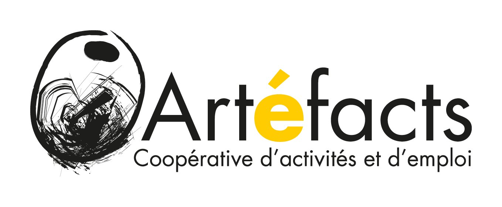

# Enveloppe icosaédrique 3 750 m³

```js
const viewerUrl = await FileAttachment("enveloppe-3d-viewer.html").url();

display(html`
<div style="display: flex; justify-content: space-between; align-items: center; margin-bottom: 1rem; flex-wrap: wrap; gap: 0.5rem;">
  <span style="color: var(--theme-foreground-muted); font-size: 0.95rem;">
    Visualisation 3D interactive (Three.js) &middot; Arête 12 m, hauteur &approx; 21 m, 3 passagers + 1 pilote
  </span>
  <a href="${viewerUrl}" target="_blank" rel="noopener noreferrer" style="display: inline-flex; align-items: center; gap: 6px; padding: 6px 12px; background: var(--theme-foreground-focus, #3b82f6); color: white; border-radius: 6px; text-decoration: none; font-size: 0.85rem; font-weight: 500;">
    <span>Ouvrir en plein écran</span>
    <svg width="14" height="14" viewBox="0 0 24 24" fill="none" stroke="currentColor" stroke-width="2" stroke-linecap="round" stroke-linejoin="round"><path d="M18 13v6a2 2 0 0 1-2 2H5a2 2 0 0 1-2-2V8a2 2 0 0 1 2-2h6"></path><polyline points="15 3 21 3 21 9"></polyline><line x1="10" y1="14" x2="21" y2="3"></line></svg>
  </a>
</div>

<div class="card" style="padding: 0; overflow: hidden; border-radius: 8px; box-shadow: 0 4px 12px rgba(0,0,0,0.08); border: 1px solid var(--theme-foreground-faintest);">
  <iframe
    src="${viewerUrl}"
    width="100%"
    height="780"
    style="border: none; display: block; width: 100%; height: 75vh; min-height: 600px;"
    title="Enveloppe icosaédrique 3D">
  </iframe>
</div>
`);
```

---

#### Erwan BOZEC - Philippe Rivière - Luc Léger - Aline Perdereau, Néguentropie
Copyleft: cette œuvre est libre, vous pouvez la copier, la diffuser et la modifier selon les termes de la [Licence Art Libre](http://www.artlibre.org)



[https://artefacts.coop](https://artefacts.coop/)
