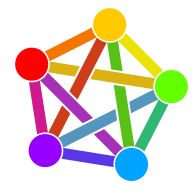
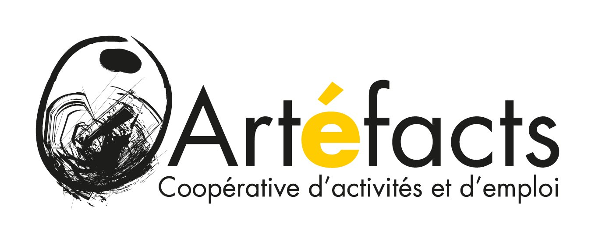

```js
import {arbre} from "./components/arbre.js";
import {cadre} from "./components/cadre.js";
import {graphe} from "./graphiques/graphe.js";
import {lorenz} from "./graphiques/lorenz.js";
```

<div class="hero">
  <h1> Néguentropie </h1>
</div>

```html
<div class="accueil-images">
  <figure style="flex: 1.778">
    
    <figcaption>Image <a href="https://pixflowave.fr/">Erwan Bozec</a> réalisée avec <a href="https://www.blender.org/">Blender</a></figcaption>
  </figure>
  <figure style="flex: 2">
    
    <figcaption>Attracteur de Lorenz sur la carte Airocean, aux couleurs du Fediverse </figcaption>
  </figure>
</div>
```
## Œuvre

```html
  <div class="card">
    <p>L'Installation artistique <strong><em>Néguentropie</em></strong> se base sur la notion d'art en tant qu'expérience à vivre. C’est une invitation à la recherche du point gris.
    <blockquote>
    <cite>" Paul Klee dit de même, dans un autre langage, que le monde naît du point gris par lui-même chaos. « Le moment cosmogénétique est là : la fixation d’un point gris dans le chaos. » "</cite>
    
    <footer>— Henri Maldiney L’esthétique des rythmes</footer>
    </blockquote>
    Cette recherche se décline concrètement par l'aménagement scénographique et mobilier d'un espace propice à l'expérimentation.
    
    <blockquote><cite>" L’ouvrage peut ouvrir le monde d’un petit jardin, plus ou moins secret, qui constitue un espace singulier par quelqu’un qui y produit ce que, dans un langage scientifique, on appellerait de la néguentropie – de la diversification, de la bifurcation, de l’inattendu, de l’improbable, de l’inespéré. "</cite>
    
    <footer>— B. Stiegler, L’Emploi est mort, vive le travail</footer>
    </blockquote>
    </p>
  </div>
```

### Projection Airocean | Attracteur étrange de Lorenz

```js
display(cadre(await lorenz(), {
  titre: "Attracteur étrange de Lorenz tracé sur la carte Airocean",
  notebook: "@pixflowave/airocean-attracteur-de-lorenz"
}))
```

### Graphique Noodiversité
#### Graphe réticulé

```js
display(cadre(await graphe(), {
  titre: "Graphe réticulé des bifurcations noétiques",
  notebook: "@pixflowave/graph_neguentropie",
  hauteur: 600
}))
```

La vidéo *Reboute — le projet Néguentropie* est sur la page [Rencontres & Publications](rencontres).

---

### Néguentropie - 2020
#### Résidence artistique - Artéfacts

```js
const Néguentropie = [
  "Néguentropie/Aline Perdereau",
  "Néguentropie/Erwan Bozec",
  "Néguentropie/Philippe Rivière",
  "Néguentropie/Luc Léger",
  ]
```

```js
arbre(Néguentropie)
```

## Rencontres

### [Néguentropie Frontière - 2021](https://tekhne.neguentropie.art/+neguentropie/neguentropie-frontiere/publications/neguentropie-fontiere?display=section)
#### Atelier de la Morinerie - Tours
[Récit « 360 »](https://tekhne.neguentropie.art/+neguentropie/neguentropie-frontiere/publications/recit-360-de-la-premiere-rencontre-neguentropie-frontiere?display=slides)

```js
arbre(NéguentropieFrontière)
```
```js
const NéguentropieFrontière = [
  "Néguentropie Frontière/Mélissa Plet-Whyckhuyse",
  "Néguentropie Frontière/Aline Perdereau",
  "Néguentropie Frontière/Erwan Bozec",
]
```

### [Néguentropie](https://tekhne.neguentropie.art/+neguentropie/neguentropie-a-la-fabrique-de-blois/publications/neguentropie-la-fabrique-de-blois?display=section)
#### La Fabrique de Blois - 2021

```js
arbre(NéguentropieLaFabriqueDeBlois2021, {marginTop: 75, marginBottom: 75})
```

```js
const NéguentropieLaFabriqueDeBlois2021 = [
  "Néguentropie/Erwan Bozec",
  "Néguentropie/La Fabrique de Blois",
]
```

### [Néguentropie](https://tekhne.neguentropie.art/+neguentropie/neguentropie-la-fabrique-de-blois-2022/publications/neguentropie-la-fabrique-de-blois-2022?display=section)
#### La Fabrique de Blois - 2022

```js
arbre(NéguentropieLaFabriqueDeBlois)
```

```js
const NéguentropieLaFabriqueDeBlois = [
  "Néguentropie/Anne Alombert",
  "Néguentropie/Erwan Bozec",
  "Néguentropie/Antoine Moreau",
  "Néguentropie/La Fabrique de Blois",
]
```

### [Pour un numérique néguanthropique](https://tekhne.neguentropie.art/+neguentropie/pour-un-numerique-neguanthropique/publications/presentation-de-neguentropie-irisa?display=slides) - 2023
##### Des technologies pour favoriser la noodiversité
#### Si. — Séance inaugurale - La méthodologie de la singularité - Paris

```js
arbre(Néguanthropique, {height: 150, marginTop: 75})
```

```js
const Néguanthropique = [
  "Pour un Numérique Néguanthropique/Anne Alombert",
  "Pour un Numérique Néguanthropique/Erwan Bozec",
]
```

### [Méta-Humus - 2023](https://www.msh-vdl.fr/actualite/human-tech-days-meta-humus/)
#### Maison des Sciences de l'Homme - Val de Loire

```js
arbre(MétaHumus)
```

```js
const MétaHumus = [
  "Méta-Humus/Anne Alombert",
  "Méta-Humus/Erwan Bozec",
  "Méta-Humus/Jean-Paul Thibeau",
  "Méta-Humus/Luc Léger",
]
```

## Bifurcations & Projets émergents

### [Néguanthropocène](neguanthropocene) - 2021

```js
arbre(Néguanthropocéne)
```

```js
const Néguanthropocéne = [
  "Néguanthropocène/Camille Guyon Taillens",
  "Néguanthropocène/Jean-Paul Thibeau",
  "Néguanthropocène/Erwan Bozec",
  "Néguanthropocène/Philippe Carré",
  "Néguanthropocène/Manuel Herreno",
  "Néguanthropocène/Olivier Heinry",
]
```

### Habitus - 2021

```js
arbre(Habitus)
```

```js
const Habitus = [
  "Habitus/Julia Nivan",
  "Habitus/Camille Guyon Taillens",
  "Habitus/Jean-Paul Thibeau",
  "Habitus/Erwan Bozec",
  "Habitus/Benjamin Cadon",
]
```

### Humus - 2022

```js
arbre(Humus)
```

```js
const Humus = [
  "Humus/Laurie Dufrenne",
  "Humus/Laurie Pailler",
  "Humus/Erwan Bozec",
]
```

### Publications & Rencontres
L'article paru dans *Cartes & Géomatique* (2024), la chronologie des rencontres, la vidéo Reboute et les autres publications sont réunis sur la page [Rencontres & Publications](rencontres).

---
## À vous de bifurquer !
### Espace contributif : [tekhne.neguentropie.art](https://tekhne.neguentropie.art/)
---
## [Documentation](https://neguentropie.art/?section=section-1759686184677.meta.txt)
---
## Co-auteurs | Néguanthropologues

### [Erwan Bozec](https://www.artefacts.coop/cooperataires/pixflowave-erwan-bozec/)
Artiste | Néguanthropologue d'expériences collectives favorisant “l’être-au-monde” et l’autonomie du citoyen.

[Pixflowave](https://pixflowave.fr/)

### Aline Perdereau
#### Conduite de projet culturel, ingénierie pédagogique

Formée en Arts plastiques à l’université de Rennes, elle fut à la tête d’un service de l’architecture et du patrimoine pendant 5 ans. Dans la coopérative Artefacts jusqu’en 2020, elle a construit et mené plusieurs ateliers d’arts plastiques avec différents publics. Elle a assuré pendant 2 ans la coordination pédagogique de l’école d’art de Blois.

### [Philippe Rivière](https://www.artefacts.coop/cooperataires/philippe-riviere/)
#### journalisme, code, cartographie

Journaliste et programmeur, il s’intéresse désormais à la cartographie et à la visualisation de données. Il anime le site Internet de réflexion sur les représentations du monde.

[visionscarto.net](https://visionscarto.net/)

### [Luc Léger](https://www.artefacts.coop/cooperataires/luc-leger/)
#### Créateur numérique et modélisation

De formation initiale en développement informatique, il utilise depuis plus de 10 ans des outils de modélisation 3D. Son parcours mixe à la fois la création d’applications numériques et la réalisation d’objets interactifs.


#### Erwan BOZEC - Philippe Rivière - Luc Léger - Aline Perdereau, Néguentropie, 2020
Copyleft : sauf mention contraire, cette œuvre est libre, vous pouvez la copier, la diffuser et la modifier selon les termes de la [Licence Art Libre](https://artlibre.org).

**Sources et crédits de cette page**
- Image d'accueil : Erwan Bozec, réalisée avec [Blender](https://www.blender.org/).
- Couleurs du graphique Lorenz (terres et petit logo) : logo du [Fediverse](https://fr.wikipedia.org/wiki/Fediverse) , Eukombos et Dr. Quadragon (domaine public).
- Projection Airocean et attracteur de Lorenz, graphe réticulé : Pixflowave, d'après ses notebooks [ObservableHQ](https://observablehq.com/) ([Airocean × Lorenz](https://observablehq.com/@pixflowave/airocean-attracteur-de-lorenz), [graphe Néguentropie](https://observablehq.com/@pixflowave/graph_neguentropie)), portés dans Framework. Carte : Philippe Rivière ([pavage de l'icosaèdre](https://observablehq.com/@fil/triangular-tiling-of-icosahedron), [projection Airocean](https://observablehq.com/@fil/airocean-projection)), contours [Natural Earth](https://www.naturalearthdata.com/) ; attracteur : Edward N. Lorenz (1963).
- Arbres des participants : [Observable Plot](https://observablehq.com/plot/).

<div style="text-align: center;">
  <br>
  <a href="https://artefacts.coop/">https://artefacts.coop</a>
</div>

---

