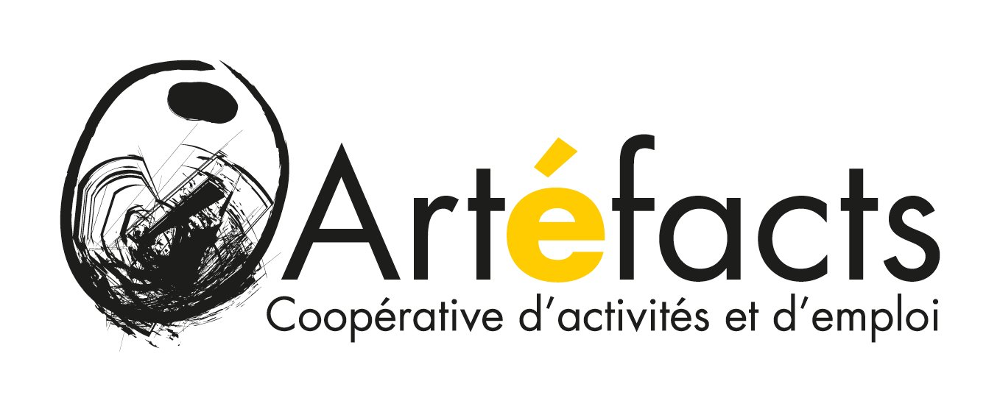

# Rencontres & Publications

Les rencontres, ateliers et résidences de **Néguentropie** constituent des moments d'expérimentation collective visant à produire de la bifurcation noétique, à questionner les représentations cartographiques et numériques, et à documenter des savoirs contributifs sous [Licence Art Libre](http://www.artlibre.org).

---

## Publication scientifique & Printemps des Cartes 2024

  

    Publication 2024
    Comité français de cartographie &middot; Revue <em>Cartes et géomatique</em>
  

  <h2 style="margin-top: 0.5rem; margin-bottom: 0.75rem; font-size: 1.35rem;">
    Néguentropie. Inscrire le monde sous licence art libre pour tenter de le réenchanter
  </h2>

  

    <strong>Auteur :</strong> Erwan Bozec (<em>Artéfacts</em>) &middot; Présenté lors du <strong>Printemps des cartes 2024</strong> (Montmorillon)
  

  <blockquote>
    

      « Comme l’a montré le philosophe Bernard Stiegler, les technologies numériques sont intrinsèquement ambivalentes : lorsqu’elles sont mises au service de l’économie des données et de la captation des attentions, elles donnent lieu à des processus d’uniformisation des pensées et de grégarisation des comportements. À l’inverse, lorsqu’elles sont conçues et développées comme des supports de savoirs contributifs, elles permettent l’expression des singularités et la confrontation des points de vue. Face aux innovations disruptives, comment mettre le numérique au service de la « néguanthropie », c’est-à-dire au service de la diversité noétique et de l’intelligence collective ? L’œuvre Néguentropie est une installation artistique qui vise à mobiliser les savoir-faire des participant.es en leur proposant de réaliser la construction d’un espace ludique et d’expérimenter un atelier de cartographie. À partir des recherches de Bernard Stiegler sur la néguanthropie, de Philippe Rivière sur les projections cartographiques et de quelques références au monde de Jean Oury, l’atelier, réalisé lors du Printemps des cartes 2024 a permis de découvrir la diversité des représentations possibles de la planète et d’interroger leurs influences sur notre perception du monde. »
    

  </blockquote>

  

    <a href="https://hal.science/CFC-CARTES-ET-GEOMATIQUE/hal-05035112v1" target="_blank" rel="noopener noreferrer" style="display: inline-flex; align-items: center; gap: 6px; padding: 7px 14px; background: var(--theme-foreground-focus); color: var(--theme-background); border-radius: 6px; text-decoration: none; font-size: 0.85rem; font-weight: 500;">
      Notice HAL (hal-05035112)
      <svg width="14" height="14" viewBox="0 0 24 24" fill="none" stroke="currentColor" stroke-width="2" stroke-linecap="round" stroke-linejoin="round"><path d="M18 13v6a2 2 0 0 1-2 2H5a2 2 0 0 1-2-2V8a2 2 0 0 1 2-2h6"></path><polyline points="15 3 21 3 21 9"></polyline><line x1="10" y1="14" x2="21" y2="3"></line></svg>
    </a>
    <a href="https://dx.doi.org/10.62437/6724690" target="_blank" rel="noopener noreferrer" style="display: inline-flex; align-items: center; gap: 6px; padding: 7px 14px; background: var(--theme-background-alt); color: var(--theme-foreground); border: 1px solid var(--theme-foreground-faintest); border-radius: 6px; text-decoration: none; font-size: 0.85rem; font-weight: 500;">
      DOI : 10.62437/6724690
    </a>
    <a href="https://hal.science/hal-05035112v1/file/Ne%CC%81guentropie.pdf" target="_blank" rel="noopener noreferrer" style="display: inline-flex; align-items: center; gap: 6px; padding: 7px 14px; background: var(--theme-background-alt); color: var(--theme-foreground); border: 1px solid var(--theme-foreground-faintest); border-radius: 6px; text-decoration: none; font-size: 0.85rem; font-weight: 500;">
      Télécharger le PDF
    </a>
    <a href="https://tekhne.neguentropie.art/+neguentropie/neguentropie-festival-printemps-des-cartes/publications/printemps-des-cartes?display=section" target="_blank" rel="noopener noreferrer" style="display: inline-flex; align-items: center; gap: 6px; padding: 7px 14px; background: transparent; color: var(--theme-foreground-focus); border: 1px solid var(--theme-foreground-focus); border-radius: 6px; text-decoration: none; font-size: 0.85rem; font-weight: 500;">
      Carnet de bord de l'atelier
    </a>
  

---

## Chronologie des rencontres en présentiel

  

    
Mai 2024 &middot; Montmorillon

    <h3 style="margin-top: 0; margin-bottom: 0.5rem; font-size: 1.15rem;">Printemps des Cartes</h3>
    

      Atelier de cartographie expérimentale et construction participative explorant la diversité des projections terrestres et leurs répercussions sur nos imaginaires.
    

    <a href="https://tekhne.neguentropie.art/+neguentropie/neguentropie-festival-printemps-des-cartes/publications/printemps-des-cartes?display=section" target="_blank" rel="noopener noreferrer" style="font-size: 0.85rem; color: var(--theme-foreground-focus); font-weight: 500;">
      Consulter la documentation &rarr;
    </a>
  

  

    
Avril 2024 &middot; Tours

    <h3 style="margin-top: 0; margin-bottom: 0.5rem; font-size: 1.15rem;">Université de Tours</h3>
    

      Résidence et installation à l'UFR Arts & Sciences Humaines du 2 au 12 avril 2024. Partage d'expériences avec les étudiants et enseignants-chercheurs.
    

    <a href="https://tekhne.neguentropie.art/+neguentropie/neguentropie-universite-de-tours/publications/ufr-art-sciences-humaines?display=section" target="_blank" rel="noopener noreferrer" style="font-size: 0.85rem; color: var(--theme-foreground-focus); font-weight: 500;">
      Consulter la documentation &rarr;
    </a>
  

  

    
Juin 2023 &middot; Tours

    <h3 style="margin-top: 0; margin-bottom: 0.5rem; font-size: 1.15rem;">Méta-Humus | Human Tech Days</h3>
    

      Rencontres à la Maison des Sciences de l'Homme (MSH) du Val de Loire du 27 au 29 juin 2023. Exploration des milieux noétiques et des savoirs contributifs.
    

    

      <a href="https://www.msh-vdl.fr/actualite/human-tech-days-meta-humus/" target="_blank" rel="noopener noreferrer" style="font-size: 0.85rem; color: var(--theme-foreground-focus); font-weight: 500;">
        Présentation sur le site de la MSH &rarr;
      </a>
      <a href="https://tekhne.neguentropie.art/+neguentropie/meta-humus/publications/meta-humus-msh-val-de-loire-htd-2023?display=slides" target="_blank" rel="noopener noreferrer" style="font-size: 0.85rem; color: var(--theme-foreground-focus); font-weight: 500;">
        Consulter la documentation &rarr;
      </a>
    

  

  

    
Avril 2023 &middot; Paris

    <h3 style="margin-top: 0; margin-bottom: 0.5rem; font-size: 1.15rem;">Séance inaugurale <em>Si.</em></h3>
    

      <em>La méthodologie de la singularité</em> — Pour un numérique néguanthropique : des technologies pour favoriser la noodiversité (IRISA / Paris).
    

    <a href="https://tekhne.neguentropie.art/+neguentropie/pour-un-numerique-neguanthropique/publications/presentation-de-neguentropie-irisa?display=slides" target="_blank" rel="noopener noreferrer" style="font-size: 0.85rem; color: var(--theme-foreground-focus); font-weight: 500;">
      Voir les diapositives de la séance &rarr;
    </a>
  

  

    
Mai 2022 &middot; Blois

    <h3 style="margin-top: 0; margin-bottom: 0.5rem; font-size: 1.15rem;">La Fabrique de Blois &middot; HTD 2022</h3>
    

      Rencontres des 6 et 13 mai 2022 à La Fabrique de Blois. Montage et expérimentation de la structure géodésique en bambou avec les publics jeunes.
    

    <a href="https://tekhne.neguentropie.art/+neguentropie/neguentropie-la-fabrique-de-blois-2022/publications/neguentropie-la-fabrique-de-blois-2022?display=section" target="_blank" rel="noopener noreferrer" style="font-size: 0.85rem; color: var(--theme-foreground-focus); font-weight: 500;">
      Consulter la documentation &rarr;
    </a>
  

  

    
Mai 2021 &middot; Blois & Saint-Pierre-des-Corps

    <h3 style="margin-top: 0; margin-bottom: 0.5rem; font-size: 1.15rem;">Premières rencontres HTD 2021</h3>
    

      Rencontres à La Fabrique (Blois) et aux Ateliers de la Morinerie (Saint-Pierre-des-Corps). Récits fondateurs <em>Néguentropie-Frontière</em>.
    

    

      <a href="https://tekhne.neguentropie.art/+neguentropie/neguentropie-a-la-fabrique-de-blois/publications/neguentropie-la-fabrique-de-blois?display=section" target="_blank" rel="noopener noreferrer" style="font-size: 0.85rem; color: var(--theme-foreground-focus); font-weight: 500;">
        Fabrique de Blois &rarr;
      </a>
      <a href="https://tekhne.neguentropie.art/+neguentropie/neguentropie-frontiere/publications/neguentropie-fontiere?display=section" target="_blank" rel="noopener noreferrer" style="font-size: 0.85rem; color: var(--theme-foreground-focus); font-weight: 500;">
        Récit de la rencontre &rarr;
      </a>
      <a href="https://tekhne.neguentropie.art/+neguentropie/neguentropie-frontiere/publications/recit-360-de-la-premiere-rencontre-neguentropie-frontiere?display=slides" target="_blank" rel="noopener noreferrer" style="font-size: 0.85rem; color: var(--theme-foreground-focus); font-weight: 500;">
        Récit « 360 » &rarr;
      </a>
    

  

---

## Vidéos & Documents contributifs

### Reboute Arts et Technologies (ré) approprié - Projet Néguentropie

  <iframe
    title="Reboute Arts et Technologies (ré) approprié - Projet Néguentropie"
    width="100%"
    height="480"
    src="https://tube.futuretic.fr/videos/embed/hokQhxiEMJegDSWxzWWqSP"
    frameborder="0"
    allowfullscreen=""
    sandbox="allow-same-origin allow-scripts allow-popups"
    style="border: none; display: block; width: 100%;">
  </iframe>

### Autres publications & références

- Publication de Philippe Rivière sur [Observable](https://observablehq.com/@visionscarto/neguentropie) dans le cadre du ***#30DayMapChallenge***.
- Inscription des différents projets issus de Néguentropie sur le ***Centre de Ressources pour les Arts et les Cultures Numériques en région Centre-Val de Loire*** : [CRACN Néguentropie](https://cracn.fr/books/neguentropie).
- Publication sur le site [Organoesis](https://organoesis.org/projets-contributifs/neguentropie) suite à la rencontre avec ***Anne Alombert***.
- Publication sur le site [oeuvres.artlibre](https://oeuvres.artlibre.org/neguentropie) suite à la rencontre avec ***Antoine Moreau***.

### Espace de documentation contributive

Tous les récits, protocoles d'ateliers, photographies et traces de fabrication sont documentés et archivés sur la plateforme contributive :

  <a href="https://tekhne.neguentropie.art/" target="_blank" rel="noopener noreferrer" style="font-size: 1.1rem; font-weight: bold; color: var(--theme-foreground-focus);">
    &rarr; https://tekhne.neguentropie.art/
  </a>

---

#### Erwan BOZEC - Philippe Rivière - Luc Léger - Aline Perdereau, Néguentropie
Copyleft : sauf mention contraire, cette œuvre est libre, vous pouvez la copier, la diffuser et la modifier selon les termes de la [Licence Art Libre](https://artlibre.org).

**Sources et crédits de cette page**
- Article : © Erwan Bozec, revue *Cartes & Géomatique* (Comité français de cartographie), notice [HAL](https://hal.science/hal-05035112v1).
- Vidéo : *Reboute Arts et Technologies (ré) approprié - Projet Néguentropie*, chaîne [Pixflowave](https://tube.futuretic.fr/video-channels/pixflowave) sur l'instance PeerTube tube.futuretic.fr, sous licence [CC BY-NC-SA 4.0](https://creativecommons.org/licenses/by-nc-sa/4.0/deed.fr).

   
  <a href="https://artefacts.coop/">https://artefacts.coop</a>

